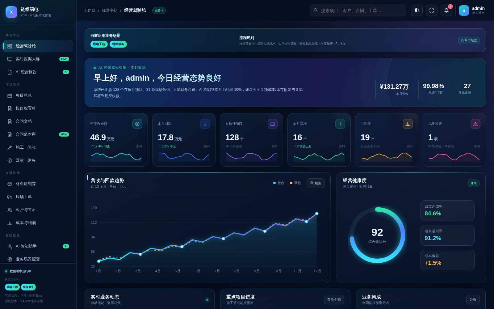
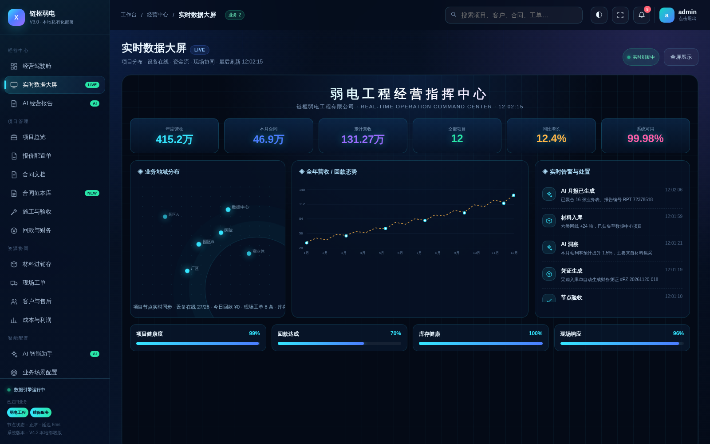
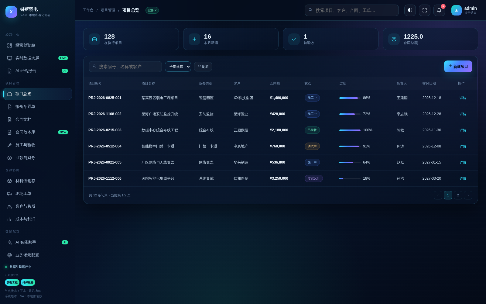
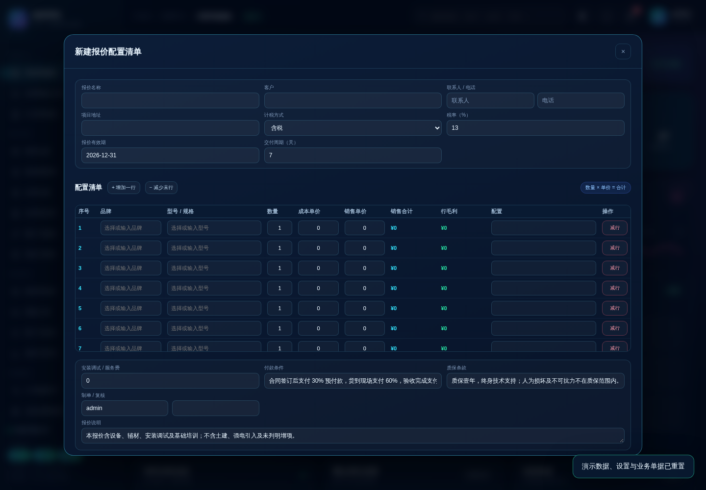
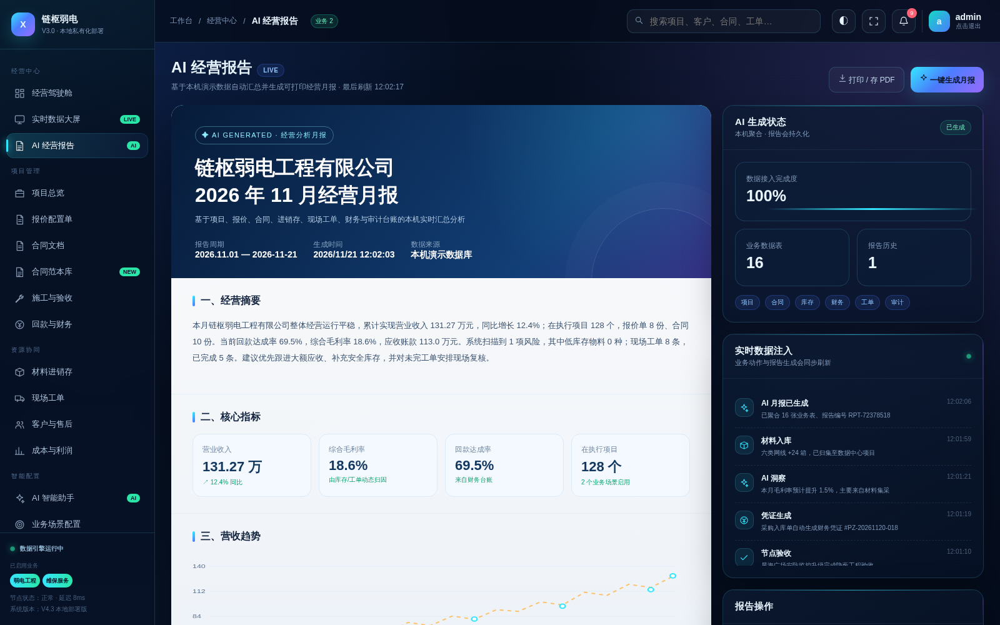
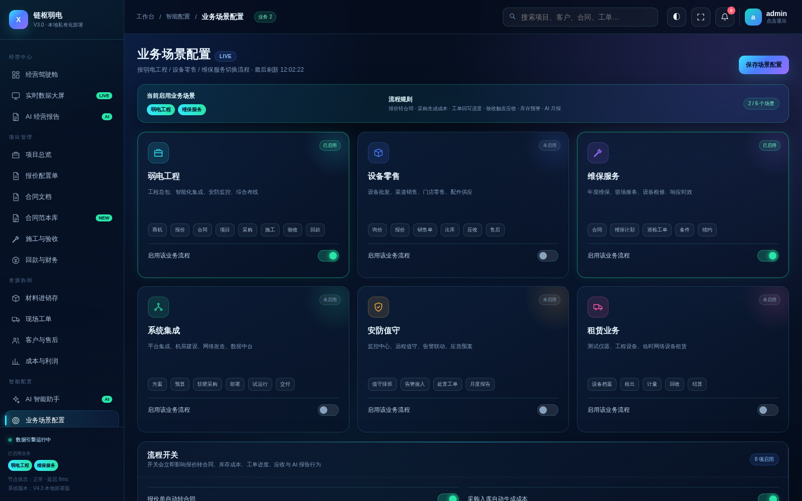
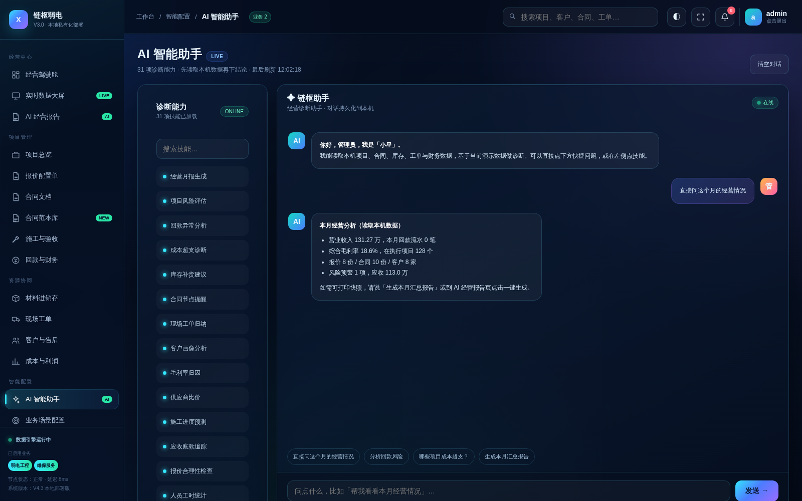

# 曜维云 · YaoWei Cloud

> 把报价、合同、成本、库存、回款、现场工单和经营驾驶舱，装进一个弱电工程经营平台。

   

曜维云是一套面向**弱电工程商、机电承包商、系统集成商和项目服务商**的本地化经营平台。它把经营驾驶舱、实时大屏、报价配置、合同文档、项目施工、采购库存、回款财务、成本利润、现场工单、业务场景、导出中心和授权系统整合为一套轻量私有部署方案。

> **商机报价 → 合同签订 → 项目施工 → 采购领料 → 回款财务 → 成本利润 → 经营驾驶舱 / AI 报告 → 导出归档**

本仓库是**公开介绍仓库**：提供项目说明、Docker Hub 镜像拉取、Docker Compose、飞牛 FPK、部署文档和界面截图。核心源码位于私有仓库 `yaowei-cloud-core`。

---

## 界面预览

| 登录页 | 经营驾驶舱 |
| --- | --- |
|  |  |

| 实时大屏 | 项目管理 |
| --- | --- |
|  |  |

| 报价配置单 | AI 经营报告 |
| --- | --- |
|  |  |

| 业务场景 | AI 智能助手 |
| --- | --- |
|  |  |

---

## 核心功能

| 模块 | 能力 |
| --- | --- |
| 经营驾驶舱 | 年度合同额、回款、活跃项目、风险、毛利、经营健康分、实时动态 |
| 实时大屏 | 全屏深色大屏、项目进度、库存预警、回款达成、实时告警、经营趋势 |
| 报价配置 | 清单式报价、成本价、毛利、含税 / 不含税、阶梯规则、打印预览 |
| 合同文档 | 范本库、逐行预览、合同台账、打印 / Word 导出 |
| 项目施工 | 项目总览、节点进度、施工与验收、现场工单、巡检记录 |
| 采购库存 | 采购入库、领料出库、移动加权成本、库存台账、安全库存预警 |
| 财务回款 | 回款凭证、应收应付、财务台账、真实成本利润核算 |
| 导出中心 | CSV / Excel / Word / JSON 账套，导入完整账套 |
| AI 助手 | 经营诊断、报告快照、自然语言问答、报告历史 |
| 授权系统 | 7 天试用、永久授权码、设备绑定、后台记录、解绑 / 吊销、NAS 服务端授权备份 |

---

## 镜像与版本

- Docker Hub：<https://hub.docker.com/r/xiaoluya/yaowei-cloud-suite>
- 固定版本：`xiaoluya/yaowei-cloud-suite:v5.0.19`
- 当前 digest：`sha256:23f2844d7af9aaf5963e8fa6deb06f857cbfa0d1c7fd64bf3d7b170dae4df90d`
- 默认端口：`8899`

---

## Docker Compose 安装

新建 `/opt/yaowei-cloud` 目录，保存以下内容为 `docker-compose.yml`：

```yaml
services:
  yaowei-cloud:
    image: xiaoluya/yaowei-cloud-suite:v5.0.19@sha256:23f2844d7af9aaf5963e8fa6deb06f857cbfa0d1c7fd64bf3d7b170dae4df90d
    container_name: yaowei-cloud
    restart: unless-stopped
    ports:
      - "8899:80"
    volumes:
      - ./data:/app/data
    environment:
      TZ: Asia/Shanghai
      PORT: "80"
      YAOWEI_LICENSE_SKU: "yaowei-cloud-suite"
      YAOWEI_LICENSE_OFFLINE_GRACE_DAYS: "7"
      YAOWEI_TRIAL_DAYS: "7"
      YAOWEI_LICENSE_ALLOW_LOCAL: "0"
      YAOWEI_LICENSE_REQUIRE_EXPORT: "1"
      YAOWEI_LICENSE_REQUIRE_IMPORT: "1"
      YAOWEI_STATE_AUTOSAVE: "1"
      YAOWEI_STATE_FILE: "/app/data/state.json"
      YAOWEI_LICENSE_STATE_FILE: "/app/data/license-state.json"
      YAOWEI_TRIAL_FILE: "/app/data/trial.json"
    healthcheck:
      test: ["CMD", "node", "-e", "fetch('http://127.0.0.1/health').then(r=>process.exit(r.ok?0:1)).catch(()=>process.exit(1))"]
      interval: 30s
      timeout: 5s
      retries: 3
      start_period: 10s
```

初始化并启动：

```bash
mkdir -p /opt/yaowei-cloud/data
cd /opt/yaowei-cloud
# 将上面的 docker-compose.yml 保存到当前目录
docker compose pull
docker compose up -d
docker compose logs -f --tail=80
```

访问：

```text
http://服务器IP:8899
```

健康检查与数据接口：

```bash
curl http://127.0.0.1:8899/health
curl http://127.0.0.1:8899/api/state
curl http://127.0.0.1:8899/api/license-state
```

默认账号：

```text
admin / admin123
```

> 正式使用请先完成软件授权，并在系统设置中修改密码。

---

## 飞牛 NAS 安装包

- [GitHub Releases / v5.0.19](https://github.com/xiaolurenya/yaowei-cloud/releases/tag/v5.0.19)
- 附件：`YaoWeiCloud-v5.0.19-Feiniu.fpk`
- 安装向导可自定义访问端口，默认 `8899`
- 业务数据保存到 `YaoWeiCloud/data/state.json`
- 服务端授权备份保存到 `YaoWeiCloud/data/license-state.json`
- 试用期文件：`YaoWeiCloud/data/trial.json`
- 升级 / 重装不要删除 `data` 目录，不要执行 `docker compose down -v`

---

## 试用与授权

- 首次安装提供 **7 天试用期**；
- 试用版不可修改公司名称与登录页信息；
- 授权提示可关闭，激活后解除限制；
- 每个客户 / 用户可生成独立 SKU；
- 授权 token 与真实 SKU、设备指纹绑定；
- 激活成功后会写入 NAS 服务端授权备份，刷新或清空浏览器授权缓存后仍可恢复；
- 后台支持授权记录、解绑设备、吊销并清设备、吊销授权码；
- 导出的业务账套不包含授权 token，导入到新设备不会自动激活。

---

## 数据与持久化

曜维云虽是轻量静态 SPA，但业务数据不再只存浏览器：

| 文件 | 用途 |
| --- | --- |
| `/app/data/state.json` | 业务账套自动保存 |
| `/app/data/trial.json` | 7 天试用期起始时间 |
| `/app/data/license-state.json` | 授权 token / 真实 SKU / 设备 ID 服务端备份 |

容器重建、浏览器清缓存、页面刷新后仍能从服务端恢复；删除 `data` 目录会同时删除业务与授权备份。

---

## 线上演示与仓库

- 线上站点：<https://yw.li0580.top>
- 公开介绍仓：<https://github.com/xiaolurenya/yaowei-cloud>
- 私有源码仓：`xiaolurenya/yaowei-cloud-core`
- Docker Hub：<https://hub.docker.com/r/xiaoluya/yaowei-cloud-suite>
- [部署说明](docs/DEPLOY.md) · [发布状态](docs/RELEASE_STATUS.md) · [版本文件](version.json)

---

文档版本：v5.0.19 · 业务场景配置页即时入口、运行自检、内置授权配置、默认 SKU 防护与服务端授权备份。